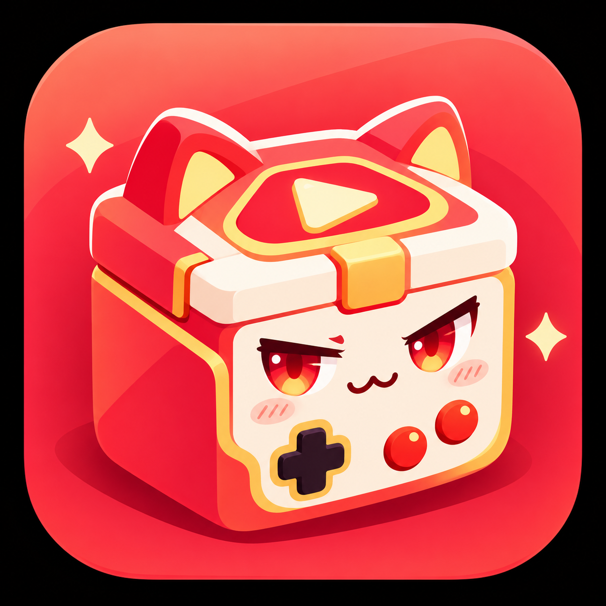

# 傲娇游戏盒

<p align="center">
  
</p>

傲娇游戏盒是一款基于 [Ruffle](https://github.com/ruffle-rs/ruffle) 修改的 Flash 游戏客户端，使用 Rust 编写。它集成游戏列表、账号登录和 Flash 播放功能，方便启动和游玩经典网页游戏。

## 支持的游戏

- **卡布西游**：使用 4399 账号登录。
- **洛克王国**：使用 QQ 官方登录。此功能目前仅在 Windows 版提供，需要安装 Microsoft Edge WebView2 Runtime。

Linux 和 WSL 版本目前提供卡布西游。洛克王国登录依赖 Windows WebView2，因此不会出现在 Linux 版的游戏列表中。

## 编译与运行

需要 Rust stable 工具链。构建包含 ActionScript 3 内置类的代码时还需要 Java，并确保 `java` 在 `PATH` 中。

### Windows

在项目根目录运行：

```powershell
cargo run --release -p ruffle_desktop
```

构建但不启动：

```powershell
cargo build --release -p ruffle_desktop
```

### Ubuntu / WSL

安装桌面版构建依赖和中文字体：

```shell
sudo apt update
sudo apt install pkg-config libasound2-dev libudev-dev libfontconfig1-dev libfreetype-dev libssl-dev default-jre-headless g++ fonts-noto-cjk
```

运行或构建：

```shell
cargo run --release -p ruffle_desktop
cargo build --release -p ruffle_desktop
```

开发预览时可以去掉 `--release`，缩短编译时间。

## 项目来源

本项目基于 Ruffle 开源 Flash Player 模拟器，并在其桌面客户端上开发游戏盒子功能。Ruffle 及其依赖的第三方组件保留各自的版权声明和许可信息；详情见下方许可说明和 [LICENSE.md](LICENSE.md)。

## License

Ruffle is licensed under either of

- Apache License, Version 2.0 (http://www.apache.org/licenses/LICENSE-2.0)
- MIT License (http://opensource.org/licenses/MIT)

at your option.

Ruffle depends on third-party libraries under compatible licenses. See [LICENSE.md](LICENSE.md) for full information.
