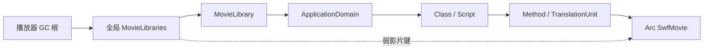

# AVM 与影片库生命周期：设计分析和下一步边界

日期：2026-10-28（Asia/Shanghai），接续 7110b44c9。

## 判断

证据指向全局资源索引的生命周期设计缺陷，不足以认定整个AVM设计不合理，也不能证明本轮卡布全部内存增长由此造成。现有GC可以回收不可达的环，但全局Library让部分定义始终可达；增加GC频率或在停战时强制回收无法解除强根。

当前使用两类所有权：不可变影片及其字节采用Arc，类/脚本/显示对象采用gc-arena。这个分工本身可以成立；问题出在全局MovieLibraries桥接两者时，弱影片键和强GC值构成自我保活关系。

这里并非单纯的、不可达的GC环。I强trace L，L通过域和定义让M保持存活，弱键因此始终有效，L也一直被trace。另一条独立路径是L→字符原型→MovieClipShared/GraphicShared→Arc SwfMovie，即便没有ABC也可保活影片。前两轮已分别用隔离测试证明。

依据：core/src/library.rs 的 MovieLibraries::trace、MovieLibrary.characters/avm2_domain；core/src/avm2/domain.rs 的 defs/classes；core/src/avm2/script.rs 的 TranslationUnitData.movie；显示对象shared定义中的movie。Domain的父→子调试列表是弱引用，不能把它误判为所有子域被父域强持有。

## 新验证：真实 unload 清除了内容，定义仍可留存

新增 player::definition_movie_retention_tests::loader_unload_releases_content_but_library_domain_retains_definition，已运行通过。

测试构造实际Loader类，取得其contentLoaderInfo，将构造的MovieClip置入实际容器，设置LoaderStream，随后调用真实LoaderInfoObject::unload。保留空Loader的动态强根，对旧内容只保留GcWeak观察，完成三轮完整GC。

两个对照的旧内容均回收；未将定义域挂入影片库时，影片也回收；挂入影片库时，影片定义继续存活。没有注册字符原型或类注册表根来混淆结果。

这是经过真实unload、容器移除和GC的离线生命周期验证，但影片/ABC定义是测试构造的，未覆盖网络和完整标签加载，也未证明游戏停战时实际调用过unload。游戏还可能合法持有ApplicationDomain、类、监听器或缓存，需区分这些来源。

LoaderInfoObject::unload目前会发unload事件、重置stream、移除内容。它没有、也不应无条件删除共享域里的定义：脚本可能仍保存类并稍后实例化，或多个Loader共用一个域。此前类注册表修复解决了一个额外全局强根，不能解除影片库这条独立路径。

## 重构方向

应让仍在使用资源的对象拥有定义，而让全局索引只负责查找。候选方向是引入GC管理的影片定义所有者，内部持有MovieLibrary、域和字符定义；全局索引持有它的可升级弱GC句柄。不可变SWF字节仍可使用Arc作为叶子数据。

活实例的共享定义、TranslationUnit/脚本方法、显式保留的类/应用域、进行中的加载以及跨影片导入，需要持有定义所有者的强GC句柄。这样无人使用的“定义→原型→定义”内部环才可能由同一个GC回收；仍能执行脚本或晚实例化的类则继续保持资源有效。

不能只把当前MovieLibraries的值改成弱引用。现有用户主要保存Arc<SwfMovie>，并未持有GC库对象；单独改弱值会让仍在使用的库被回收，造成缺图、找不到符号或域丢失。当前core中有67处library_for_movie/library_for_movie_mut调用，涉及预加载、渲染、字体、音频、类分配和调试；这不是一行weak替换能够安全完成的变更。

建议实施顺序：

1. 先确定所有定义消费者和跨影片依赖，明确每种强句柄由谁持有、何时释放。尤其检查shared图形、影片、字体、导入符号、TranslationUnit及异步预加载。
2. 在隔离实现中同时迁移拥有者与弱索引，保留单份定义身份，保证查找和预加载重入期间库不提前消失，再接入正常运行路径。
3. 离线验证：仅卸载一个Loader、保留外部类、保留外部域、共享域、多Loader同影片、跨影片导入、标签晚加载、重入unload以及AVM1导出/attachMovie。分别断言内容树和定义的可达性，不只观察OS总量。
4. 所有离线语义检查完成后，再进行有界的同资源重复加载/卸载实机验证，比较定义数量是否趋于稳定。无需再让用户长时间盲打到4–5GB。

这尚是重构方案，不是已经实现的整套修复。新unload回归和本说明未改变生产生命周期，也没有生成比weak-class-registry-20261028更新的游戏构建。

## 数值归属限制

known_movies是SwfMovie实例数量，不是唯一下载URL或唯一文件数，SwfMovie还可能表示图片/占位影片。SwfSlice独立持有Arc字节数据；仅凭影片计数或SWF payload统计不能覆盖所有存活字节。渲染网格、GPU allocator reserved、驱动提交、CPU分配器容量与碎片也有独立生命周期，不能把全部进程内存归到上述一条路径。

当前事件候选卡布数据证明了长测期间定义与网格显著累积；未提供精确停战标记、对象强根归属或逐时OS内存，所以不能直接认定每份旧定义在游戏语义上都已无用。
