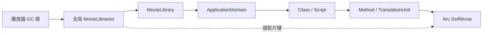

# AVM 与影片库生命周期：设计分析和下一步边界

日期：2026-10-28（Asia/Shanghai），接续 7110b44c9。

**最新状态：生产弱全局索引已经落地，见文末“全局弱索引落地”。前面的强索引引用图及两步迁移记录保留为历史证据，不代表当前代码仍有同一强根。**

## 判断

证据指向全局资源索引的生命周期设计缺陷，不足以认定整个AVM设计不合理，也不能证明本轮卡布全部内存增长由此造成。现有GC可以回收不可达的环，但全局Library让部分定义始终可达；增加GC频率或在停战时强制回收无法解除强根。

当前使用两类所有权：不可变影片及其字节采用Arc，类/脚本/显示对象采用gc-arena。这个分工本身可以成立；问题出在全局MovieLibraries桥接两者时，弱影片键和强GC值构成自我保活关系。

这里并非单纯的、不可达的GC环。I强trace L，L通过域和定义让M保持存活，弱键因此始终有效，L也一直被trace。另一条独立路径是L→字符原型→MovieClipShared/GraphicShared→Arc SwfMovie，即便没有ABC也可保活影片。前两轮已分别用隔离测试证明。

依据：core/src/library.rs 的 MovieLibraries::trace、MovieLibrary.characters/avm2_domain；core/src/avm2/domain.rs 的 defs/classes；core/src/avm2/script.rs 的 TranslationUnitData.movie；显示对象shared定义中的movie。Domain的父→子调试列表是弱引用，不能把它误判为所有子域被父域强持有。

## 新验证：真实 unload 清除了内容，定义仍可留存

新增 player::definition_movie_retention_tests::loader_unload_releases_content_but_library_domain_retains_definition，已运行通过。

测试构造实际Loader类，取得其contentLoaderInfo，将构造的MovieClip置入实际容器，设置LoaderStream，随后调用真实LoaderInfoObject::unload。保留空Loader的动态强根，对旧内容只保留GcWeak观察，完成三轮完整GC。

两个对照的旧内容均回收；未将定义域挂入影片库时，影片也回收；挂入影片库时，影片定义继续存活。没有注册字符原型或类注册表根来混淆结果。

这是经过真实unload、容器移除和GC的离线生命周期验证，但影片/ABC定义是测试构造的，未覆盖网络和完整标签加载，也未证明游戏停战时实际调用过unload。游戏还可能合法持有ApplicationDomain、类、监听器或缓存，需区分这些来源。

LoaderInfoObject::unload目前会发unload事件、重置stream、移除内容。它没有、也不应无条件删除共享域里的定义：脚本可能仍保存类并稍后实例化，或多个Loader共用一个域。此前类注册表修复解决了一个额外全局强根，不能解除影片库这条独立路径。

## 重构方向

应让仍在使用资源的对象拥有定义，而让全局索引只负责查找。候选方向是引入GC管理的影片定义所有者，内部持有MovieLibrary、域和字符定义；全局索引持有它的可升级弱GC句柄。不可变SWF字节仍可使用Arc作为叶子数据。

活实例的共享定义、TranslationUnit/脚本方法、显式保留的类/应用域、进行中的加载以及跨影片导入，需要持有定义所有者的强GC句柄。这样无人使用的“定义→原型→定义”内部环才可能由同一个GC回收；仍能执行脚本或晚实例化的类则继续保持资源有效。

不能只把当前MovieLibraries的值改成弱引用。现有用户主要保存Arc<SwfMovie>，并未持有GC库对象；单独改弱值会让仍在使用的库被回收，造成缺图、找不到符号或域丢失。当前core中有67处library_for_movie/library_for_movie_mut调用，涉及预加载、渲染、字体、音频、类分配和调试；这不是一行weak替换能够安全完成的变更。

建议实施顺序：

1. 先确定所有定义消费者和跨影片依赖，明确每种强句柄由谁持有、何时释放。尤其检查shared图形、影片、字体、导入符号、TranslationUnit及异步预加载。
2. 在隔离实现中同时迁移拥有者与弱索引，保留单份定义身份，保证查找和预加载重入期间库不提前消失，再接入正常运行路径。
3. 离线验证：仅卸载一个Loader、保留外部类、保留外部域、共享域、多Loader同影片、跨影片导入、标签晚加载、重入unload以及AVM1导出/attachMovie。分别断言内容树和定义的可达性，不只观察OS总量。
4. 所有离线语义检查完成后，再进行有界的同资源重复加载/卸载实机验证，比较定义数量是否趋于稳定。无需再让用户长时间盲打到4–5GB。

这尚是重构方案，不是已经实现的整套修复。新unload回归和本说明未改变生产生命周期，也没有生成比weak-class-registry-20261028更新的游戏构建。

## 数值归属限制

known_movies是SwfMovie实例数量，不是唯一下载URL或唯一文件数，SwfMovie还可能表示图片/占位影片。SwfSlice独立持有Arc字节数据；仅凭影片计数或SWF payload统计不能覆盖所有存活字节。渲染网格、GPU allocator reserved、驱动提交、CPU分配器容量与碎片也有独立生命周期，不能把全部进程内存归到上述一条路径。

当前事件候选卡布数据证明了长测期间定义与网格显著累积；未提供精确停战标记、对象强根归属或逐时OS内存，所以不能直接认定每份旧定义在游戏语义上都已无用。

## 2026-10-28 离线推进：外部定义持有者和迁移落点

新增 `repeated_unload_separates_content_from_external_definition_owners`：
使用实际 Loader 类、容器挂载和 LoaderInfo.unload，每种持有方式重复12轮。
三组分别为不保留定义、仅保留Class、仅保留Domain；不向MovieLibrary安装域或字符，
类注册表仍使用正常弱注册路径。每轮保持空Loader存活，先检查内容树回收，
再检查外部Class/Domain存在时定义存活、释放后影片回收；同时检查之前所有轮次影片没有残留。
这验证的是排除全局库根后的所有权基线，不代表生产影片库已迁移。

新增 `external_class_preserves_other_movies_in_shared_domain`：
两份影片向同一个Domain导出不同Class，仅保留第一份影片的Class。
没有MovieLibrary或注册表根时，两份影片依然存活；释放该Class后两份一起回收。
这里Class→Method→TranslationUnit→Domain→其他Class的保留是当前共享域语义，
所以不能把“某个Loader卸载后影片仍活着”单独当作泄漏，也不能按Loader直接删域里的类。
测试ABC仍是构造的未执行定义，不替代真实SWF加载及脚本兼容回归。

已核对的迁移落点如下；这是源码审计，不是完成迁移的声明：

| 当前消费者 | 当前拥有的数据 | 迁移时必须保证 |
| --- | --- | --- |
| MovieClipShared | movie、SwfSlice、ABC标签、importer_movie | 活时间轴和晚加载标签保持同一库身份；缓存原型内部环可回收 |
| GraphicShared / MorphShapeShared | Arc影片和形状数据 | 活图形可查位图填充；原型不能依赖全局强根保活库 |
| TextShared / EditTextShared | Arc影片和字符ID | 活文本仍能查嵌入字体与定义；目前require_static结构需要改成可trace的带生命周期结构或在实例另设所有者 |
| AVM1/AVM2 ButtonShared | Arc影片、按钮记录和声音ID | 切换按钮状态时仍可创建子符号、查声音；同样不能沿用require_static来藏GC句柄 |
| VideoData | Arc影片 | 视频定义查询和延迟解码期间保持库 |
| TranslationUnitData | Domain、Arc影片、方法/类/脚本 | 外部方法、Class及Domain间接持有库，不能只保活影片字节 |
| MovieLoader | target_clip、vm_data、预加载阶段的Arc影片 | 首次progress、replace_with_movie及预加载重入期间不能出现库被提前回收的间隙 |
| MovieClip::export_assets | 将同一个Character复制登记到导入者库 | 共享Character自身或显式依赖边必须保活来源库；只保活导入者库不够 |
| Avm2ClassRegistry | 弱Class身份、弱Arc影片、symbol ID | 外部Class强持有定义所有者后，原symbol映射继续可用 |
| Player root_swf / 根显示对象 | Arc影片与根内容 | 根库的GC所有者需要明确根来源，不能靠Arc字节存活推导GC库存活 |

`BinaryData`持有SwfSlice但本身只复制字节；不能把所有SwfSlice都机械升级为库所有者，
也不能假设只有Arc影片计数能够代表全部字节所有权。字体、全局字体缓存、音频句柄、
AVM1动作队列/导出、动态Bitmap和调试窗口仍需逐项验证；本表不宣称消费者审计已穷尽。

实现边界：下一阶段应先建立GC库所有者和弱索引的隔离原型，再迁移上述强消费者，
尤其要先处理TranslationUnit和共享域、导入Character、异步加载，以及require_static共享结构。
在这些路径没有一起接通前，生产MovieLibraries仍保持现有强trace，不提交单独弱化索引的半套修复。

### 隔离的定义所有者原型

`library::movie_library_lifetime_tests::weak_definition_index_preserves_live_imports_and_collects_dependency_cycles`
使用真实MovieLibrary和MovieClip字符，构造两个GC管理的库所有者、互相依赖的强GC边和始终留在根里的已trace弱索引。
保留一个消费者时，两份库可查，复制到导入者的Character可以晚实例化且影片身份正确；
释放最后的消费者后，弱索引不能升级，两份影片均回收，内部依赖环不会自我保活。
索引在此原型中是弱句柄列表，尚非按影片查询的生产索引。

该原型仅编译进单元测试；依赖边由测试显式建立，尚未接入真实实例、Class、TranslationUnit、
加载器或导入逻辑。它验证所有权图在gc-arena中的可行性，不证明生产所有消费者已经迁移，
也不覆盖真实异步/重入或网络标签解析。生产行为仍由现有MovieLibraries实现负责。

本轮验证：`cargo test -p ruffle_core --lib --locked --features performance_diagnostics`
154 passed、0 failed、1 ignored（既有手动实验）；新增3个测试均通过。
`cargo fmt --all -- --check`和`git diff --check`通过。
本机初次构建使用了迁移前asc crate嵌入的旧绝对路径，触发asc重新编译后恢复，无需改动生产构建代码。
未生成Windows EXE，未进行实机测试。

## 生产迁移第一步：GC库所有者和TranslationUnit强持有

本轮将生产MovieLibraries的值迁移为`MovieDefinition(Gc<RefLock<MovieLibrary>>)`，
不可变SwfMovie仍为Arc。`definition_for_movie`为同一影片返回已有所有者，
库的读写通过带GC生命周期的Ref/RefMut完成，写入必须提供Mutation以执行写屏障。
提供正确trace的MovieDefinitionWeak，为后续弱索引及测试观察准备。

普通DoAbc/DoAbc2及内置ABC加载均取得影片对应的GC所有者，传入TranslationUnit。
TranslationUnit构造要求定义所有者，不存在生产调用忘记填写可选字段的路径。
因此Class/Method/Script通过TranslationUnit可以强持有定义库，
而不只是保持Arc影片字节存活。历史隔离定义测试使用独立、未登记全局索引的空所有者，
继续排除生产库根的干扰。

新增`external_class_owns_library_after_global_index_is_removed`：构造真实Class、Method、
TranslationUnit以及MovieClip字符库，库中保存导出类的Domain，形成完整的定义环。
测试显式移除整个全局Library，只保留Class强根和已trace的弱定义观察句柄。
三轮GC后定义仍可用且符号可晚实例化；释放Class后三轮GC，定义弱句柄失效、影片释放。
移除全局Library只用于隔离测试，不是生产unload行为。

Ref/RefMut有实际的析构借用范围，不能照搬原来&mut引用依赖NLL结束借用的假设。
已将时间轴子对象创建、SymbolClass解析、子影片分段预加载、ImportAssets登记和Loader域初始化的
库借用限制在调用脚本、嵌套加载或再次查询库之前；渲染缓存回归也在绘制前显式释放写借用。

**全局MovieLibraries本轮仍强trace所有者，尚未切换弱值。**
这是一项生产所有权迁移的中间步骤，不声称降低实机影片计数或解决4–5GB问题。
当前显示对象、导入依赖、Loader在途和其他定义消费者尚未全部持有MovieDefinition，
因此单独弱化全局索引仍然不安全。类注册表的跨影片首次绑定也需特别处理：
Class可能定义在父影片，却首次关联子影片的符号，不能假设Class的TranslationUnit所有者
天然等于符号来源库。下一步迁移显示对象和符号绑定时必须覆盖这个对照。

测试内旧OwnershipPrototype仍用于依赖图对照，与本轮生产MovieDefinition的集成测试用途不同。

本轮最终代码的离线验证：核心诊断单元测试155 passed、0 failed、1 ignored；
格式及diff检查通过。SWF各组结果如下，组间有重叠，包含既有known_failure的预期差异校验；
ignored包含渲染/视频等环境限制，不是全部场景通过的声明。

| 组 | passed | failed | ignored |
| --- | ---: | ---: | ---: |
| loader | 52 | 0 | 2 |
| symbolclass | 6 | 0 | 0 |
| root | 30 | 0 | 1 |
| import | 3 | 0 | 0 |
| button | 43 | 0 | 9 |
| text | 233 | 0 | 56 |
| sound | 42 | 0 | 0 |
| application_domain | 1 | 0 | 0 |
| preload | 6 | 0 | 0 |
| attach_movie | 4 | 0 | 0 |
| bitmap | 76 | 0 | 74 |

普通桌面端`cargo check -p ruffle_desktop --locked`通过，保留既有UI dead-code等警告。

## 生产迁移第二步：实例、在途加载、符号绑定和导入依赖

显示对象基类新增已trace的MovieDefinition句柄。通过影片库按ID/导出名实例化时，
MovieLibrary通过其弱self句柄为新实例安装所有者；克隆基类时该强句柄也随实例保留。
所有post_instantiation覆盖、AVM2动态分配初始化、根影片/导入影片创建和影片替换路径均接入。
实例离开显示树时不清除此句柄，因为脚本仍可能保存实例并调用其行为；影片替换则改为新所有者，
Stage从占位影片切换到真实root_swf时也更新持有关系。

跨影片SymbolClass绑定由ClassData显式保留来源Arc影片和MovieDefinition，
不能用Class所属TranslationUnit的所有者替代。全局类注册表仍只保留弱Class身份和弱影片，
继续按原规则接受首次绑定，忽略同影片其他ID和其他影片覆盖；只有注册表实际接受新绑定时才更新Class的持有关系。
Class中的可替换RefLock保存强边，保证注册表重建后接受重新绑定时能替换旧边；
没有将不可替换OnceLock或全局强Class键引入注册表。

ImportAssets两条复制导出字符的路径同时登记来源库依赖。依赖按GC身份去重；
同ID字符登记被拒绝时，不为被忽略的来源添加依赖。依赖可以成环，但均属于GC定义图内部强边。
依赖边只指向定义所有者，未新增到Loader/LoaderInfo或内容实例的直接引用；字符现有的importer_movie等引用仍需独立审计。

MovieLoader新增在途定义所有者，真实影片解码后、首次progress回调前安装；
SWF目标替换与图片内容创建时把对应定义交给显示对象，移除加载器句柄时在途强边自然释放。
网络下载前尚无真实定义，不提前制造GC库；错误影片沿既有加载流程结束。
本轮没有改变LoaderInfo.unload的事件/容器移除/stream重置行为。

新增离线测试：

- detached_symbol_instances_retain_definitions_without_global_roots：分别保存脱离显示树的MovieClip与Graphic实例，删除全局Library；GC后库仍可晚实例化，最后实例释放后库与影片回收。
- importing_instance_preserves_source_library_and_collects_import_cycle：使用实际MovieDefinition/MovieLibrary/字符建立双向导入依赖，删除全局Library，仅保留导入实例；两个库仍有效，释放实例后依赖环和两份影片回收。依赖登记是测试构造，真实ImportAssets解析由SWF回归另行覆盖。
- parent_class_owns_first_child_symbol_library_after_global_roots_are_removed：父影片定义Class、子影片提供字符，移除全局库但保留原弱注册表；首次绑定和晚实例化保持，忽略的第三影片回收；最后Class释放后父/子影片及定义环回收。
- parsed_loader_owns_definition_after_target_movie_is_replaced：通过实际load_movie_into_clip_bytes解析构造的最小SWF，将目标换成另一影片并删除全局Library以隔离在途强边；加载器移除前定义可升级，移除后回收。这不是网络下载或回调重入的完整模拟。

原live_class回归增加注册表重建后重新绑定及最终释放的检查。所有GC观察使用已trace的弱句柄，
不以未root的GC指针跨GC周期观察，也不依赖Arc强引用数推断回收。

本轮继续保留全局MovieLibraries强trace，尚未开启弱全局索引。
字体/全局字体、AVM1动作与声音、直接取得的共享字符或定义、LoaderInfo仅保留域的访问等
消费者仍需进一步审计和验证；不能将实例层迁移完成等同于全部定义生命周期迁移完成。
尚未生成新Windows EXE或实机量化内存节省。

本轮最终验证：`cargo test -p ruffle_core --lib --locked --features performance_diagnostics`
159 passed、0 failed、1 ignored。新增4项生命周期回归和注册表重建/重新绑定检查均通过。
使用`RUFFLE_TEST_OPTS="--compile-mode use-precompiled"`运行Loader、SymbolClass、root、import、button、
text、sound、application_domain、preload、attach_movie、bitmap共11组SWF回归，全部无失败；
分组passed/ignored分别为52/2、6/0、30/1、3/0、43/9、233/56、42/0、1/0、6/0、4/0、76/74。
组间重叠，含既有known_failure差异校验及渲染环境等忽略项，不作为唯一测试数量或图像验证声明。
普通桌面`cargo check -p ruffle_desktop --locked`、格式检查和`git diff --check`通过；
桌面保留既有8项警告，核心诊断单元测试构建无新增警告。

## 全局弱索引落地：字体、AVM1代码及声音的最后一轮持有关系

MovieDefinitionData现在统一持有Arc影片和RefLock影片库。MovieLibraries的键仍为Weak影片，
值改为正确trace的MovieDefinitionWeak；get必须使用Mutation升级，失败返回None。
单独保留Arc字节不再保活GC定义；死条目可被新的定义所有者替换，不复用已销毁的符号。
known_movies只枚举未销毁定义的键；GC尚未完成时仍可能包含待sweep定义，不能将瞬时计数当作精确存活堆。

字体的FontData从静态GC负载改为带生命周期的已trace定义持有者，glyph数据仍为静态叶子。
字符登记时为字体和显示对象原型安装来源，只在尚无来源时赋值。
导入同一个Font/字符不会把它改成拥有导入者库；新实例继承原型来源，压缩位图等没有显示原型的分支由实例化库安装所有者。
新增单向导入对照：外部保留导入资源时，来源库活着、无用导入者可以回收；最后资源释放后来源也回收。

AVM1 SwfSlice只保留Arc字节，不含GC库。排队动作保存入队时的来源，函数定义保存创建时的来源，
函数调用/with作用域/构造事件/跨影片Call帧分别传播实际代码来源，避免用已被替换的base_clip推断来源。
PlaceObject事件处理器可能跨loadMovie继续存在，因此MovieClipData另有已trace的clip_event_definition；
初始化/构造/普通clip事件和duplicateMovieClip保留该来源。AVM1按钮事件相对父对象执行，但以按钮定义作为来源。
本轮未把GC句柄藏入require_static的原始字节事件记录。

声音来源使用SoundHandle→弱定义索引，登记嵌入声音时关联来源，定期清除失效弱项。
AVM1附加Sound和AVM2 Sound对象持有相应来源；开始播放时SoundInstance快照来源，流播放快照旧影片来源，
不会因为关联显示对象被替换而丢失原定义。外部loadSound切换和播放停止按原流程释放对应持有关系。
没有把全局音频查找表变成强定义根。

新增/更新的回收证据：

- 仅保留裸Arc影片或仅保留弱索引，字符/域的内部环仍能回收；失效弱条目可重新登记。
- 字体、附加声音、无显示对象的活动声音、仅路径base_clip的AVM1函数和替换目标前已入队动作，各自可以保活来源；最后持有者释放后来源回收。
- 保留PlaceObject事件的实例在影片替换后仍保活事件来源，最后实例释放后来源回收。
- 32轮实际AVM1 SWF字节加载、符号解析、动作处理、替换和加载器释放；逐轮完整GC后，所有旧定义弱观察均失效，known_movies不高于基线+当前空目标。
- 16轮构造真实AVM2 Loader，走字节加载/AS3影片预加载/帧末完成回调并调用真实LoaderInfo.unload；空Loader继续强持有，逐轮GC后全部旧定义回收、known_movies不高于基线。

上述循环使用构造SWF（含DefineSprite；AVM1另含ExportAssets，AS3含FileAttributes）。AS3帧末回调在测试中手动推进，
没有网络、完整帧调度或真实游戏ABC。它们验证原型、空Loader及定义库不再通过全局索引自我保活，
不能单独证明Roco/卡布所有定义均应卸载，也不能据此计算实机内存节省。

最终验证：核心performance_diagnostics单元测试167 passed、0 failed、1 ignored（既有手工实验）。
16组预编译SWF回归全部无失败；AVM1组795 passed/21 ignored。最后事件源持有补充后，
又复查Loader52/2、button43/9、font24/20、function45/0、event115/0、timeline69/0、AVM1 795/21（passed/ignored），全部无失败。
组间重叠，包含既有known_failure的预期差异校验，忽略项包含图像/视频等环境限制。
普通桌面及performance_diagnostics桌面cargo check、格式和diff检查通过，桌面保留既有8项警告。

本轮解决的是定义图的全局自我保活，不改变仍被脚本/共享域/全局字体/类注册等合法持有的定义生命周期。
原生堆碎片、GPU/驱动分配和音频后端的句柄/采样缓冲生命周期仍独立于GC定义图；现有音频后端没有通过本轮新增声音注销机制。
没有生成新Windows EXE或进行实机量化；不宣称整个4–5GB问题已解决。

源码与摘要以私有aojiaoxiaolinlin/ruffle-A的codex/roco-memory-investigation分支交接，fork为次要副本。
原始游戏日志、ETL、EXE/PDB及临时测试输出仍不入Git。
